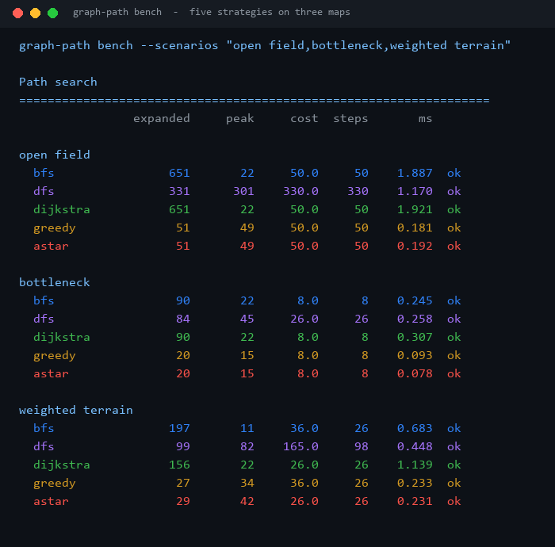
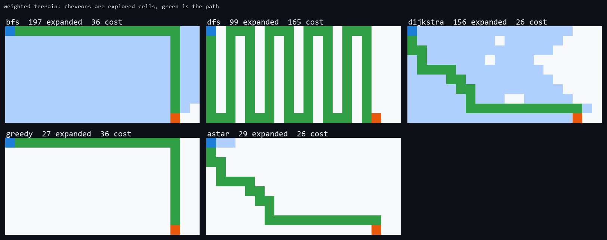
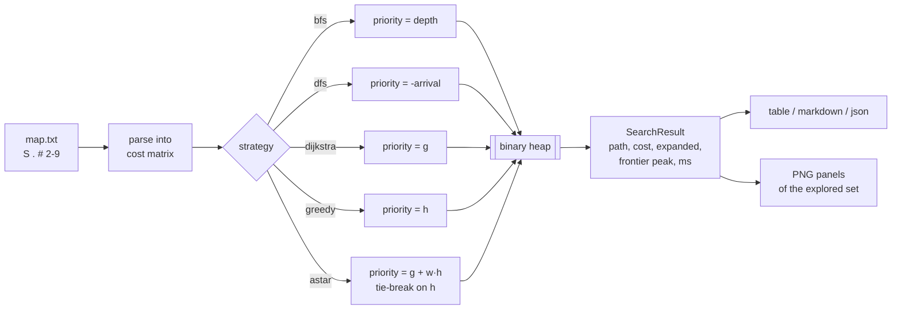
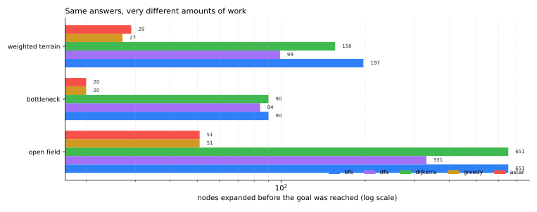

# Graph-Path-Lab

[](https://github.com/abubakarsiddique360/Graph-Path-Lab/actions/workflows/ci.yml)


Five search strategies, one grid format, one result type. BFS, DFS, Dijkstra, greedy best-first
and A* run on the same map and report the three numbers that actually differ: nodes expanded,
frontier peak, and path cost.

```text
weighted terrain
  bfs                197       11     36.0     26    0.683  ok
  dfs                 99       82    165.0     98    0.448  ok
  dijkstra           156       22     26.0     26    1.139  ok
  greedy              27       34     36.0     26    0.233  ok
  astar               29       42     26.0     26    0.231  ok
```

## The benchmark



## Why it exists

Pathfinding demos usually swap one algorithm for another and compare wall-clock time on a
machine that is doing something else. That hides the thing worth measuring: how much of the map
each strategy had to touch to be sure. On these 20-wide maps a few hundred nodes is nothing; on a
10,000-node graph the difference between 51 and 651 expansions is the difference between a
frame budget and a stall.

The lab makes the comparison honest: same grid, same tie-break rules, same result type, and a
picture of the explored set so you can see *why* the counts differ.

## What the search actually looks like



One map, five strategies, pale blue is "looked at", green is the path:

- **BFS** floods the whole map before it will commit, because it must prove no shorter path exists.
- **DFS** dives, backs out, dives again - 99 expansions but a path costing 165 instead of 26.
- **Dijkstra** spreads evenly in cost order, visiting 156 cells to prove optimality.
- **Greedy** beelines at the goal (27 expansions) and pays 36, having walked straight through the
  expensive row.
- **A\*** reaches the optimum with 29 expansions: the same answer as Dijkstra for a fifth of the work.

## How it works



Every strategy is the same loop with a different ordering key. That is not just tidy - it means
the comparison is fair, because the neighbour enumeration, the closed set and the accounting are
literally the same code.

## Results

From `docs/benchmark.json`, produced by `graph-path bench` on the bundled maps:

| Map | BFS | Dijkstra | Greedy | A* | Optimal cost |
| --- | ---: | ---: | ---: | ---: | ---: |
| open field (31x21) | 651 expanded | 651 | 51 | **51** | 50 |
| bottleneck | 90 | 90 | 20 | **20** | 8 |
| weighted terrain | 197 (cost 36) | 156 | 27 (cost 36) | 29 | 26 |



Three lessons the table makes concrete:

**Tie-breaking is a strategy too.** The first version of this A* expanded all 651 cells on an
empty field, exactly like BFS: with a consistent heuristic every frontier node has the same `f`,
so the heap order fell back to insertion order. Adding "on equal `f`, prefer the smaller `h`"
brought it to 51. No rule of A* was broken either time - the number just moved by 12x.

**Steps are not cost.** On the weighted map BFS and greedy both walk a 26-step route and both pay
36, because the cheap-looking row costs 9 per cell. Dijkstra and A* find a route with the same 26
steps that costs 26, simply by preferring cheap terrain. If your map has terrain, BFS is not "the
safe default" - it is the wrong tool.

**Explored-set size, not milliseconds, is the portable metric.** Timings on a laptop move by 2x
between runs; the expansion counts are deterministic and depend only on the map and the strategy.

## Install

```bash
pip install -e .
```

Python 3.10+, standard library only (Pillow is only needed for `scripts/render_assets.py`).

## Usage

```bash
graph-path maps
graph-path maps --show maze
graph-path solve  --map examples/maze.txt --algorithm astar --ascii
graph-path solve  --map examples/maze.txt --algorithm astar --png out.png
graph-path compare --map examples/maze.txt --png compare.png
graph-path compare --map examples/maze.txt --format markdown
graph-path bench   --scenarios "open field,weighted terrain" --format json
graph-path bench   --png maze-panels.png
```

Exit codes: `0` a path was found, `1` it was not, `2` the map or arguments are unusable.

## The map format

```text
S..2....9....2......
.22....999...2......
..2.....9....2..3...
.................G..
```

| Character | Meaning |
| --- | --- |
| `S` | start (exactly one) |
| `G` | goal (exactly one) |
| `#` | wall |
| `.` | free, cost 1 |
| `2`-`9` | terrain, that cost per entry |

Maps are validated on load: ragged rows, a missing or duplicated start/goal, and a start next to
the goal are all rejected with a message that names the problem. A test case is a string literal
and a bug report is a file you can paste.

## The result type

```json
{
  "algorithm": "astar",
  "found": true,
  "steps": 26,
  "cost": 26.0,
  "expanded": 29,
  "frontier_peak": 42,
  "elapsed_ms": 0.231,
  "path": [[0, 0], [0, 1], "..."]
}
```

`expanded` counts nodes popped from the frontier and closed - the work the algorithm did to prove
its answer. The full explored set is kept on the result for drawing but stripped from JSON, so a
10k-node map does not turn into a 10k-line report.

## Design notes and limits

- **Four-way movement.** No diagonals, so Manhattan distance is admissible. Add diagonal moves and
  the heuristic must change to octile distance or A* stops being optimal.
- **Consistent heuristics only.** `manhattan`, `euclidean`, `zero`. `zero` turns A* into Dijkstra,
  which is a useful sanity check rather than a feature.
- **Weighted A\*** (`--weight 3`) is faster and no longer guarantees the cheapest path; the report
  labels the run `astar w=3` so it cannot be mistaken for the exact variant.
- **Greedy with a zero heuristic is refused.** It degenerates into an arbitrary stack walk, and a
  number that looks like a result but is not one is worse than an error.
- **Elapsed time includes heap overhead, not map parsing** - the timer starts after the grid is
  built, so a slow disk does not flatter or punish an algorithm.

## Development

```bash
python -m pip install -e ".[dev]"
ruff check .
pytest                              # 44 tests, no network access
python scripts/render_assets.py     # regenerate docs/benchmark.json and docs/images
```

The README images are generated by this repository from its own runs; no third-party images are
bundled.

## License

MIT - see [LICENSE](LICENSE).
